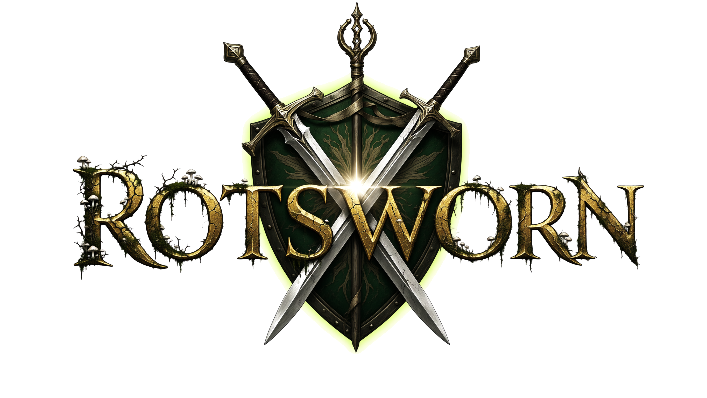
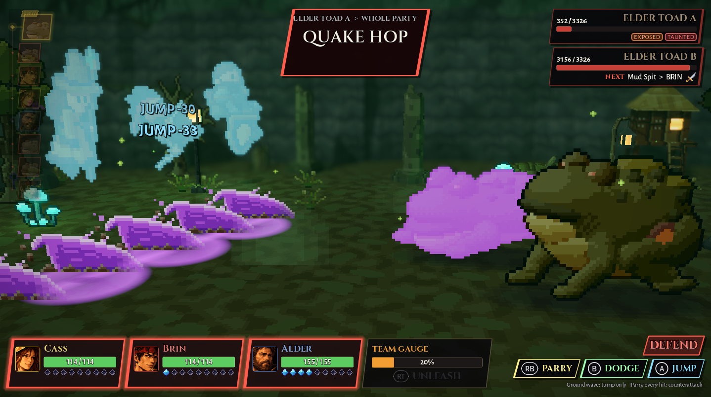
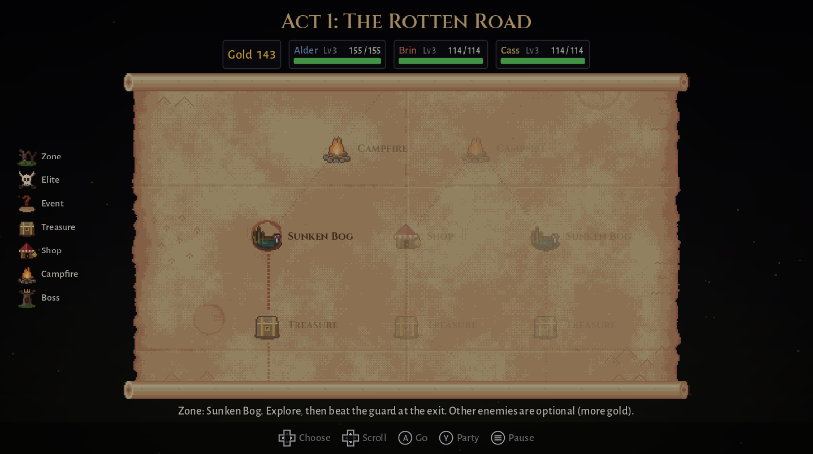
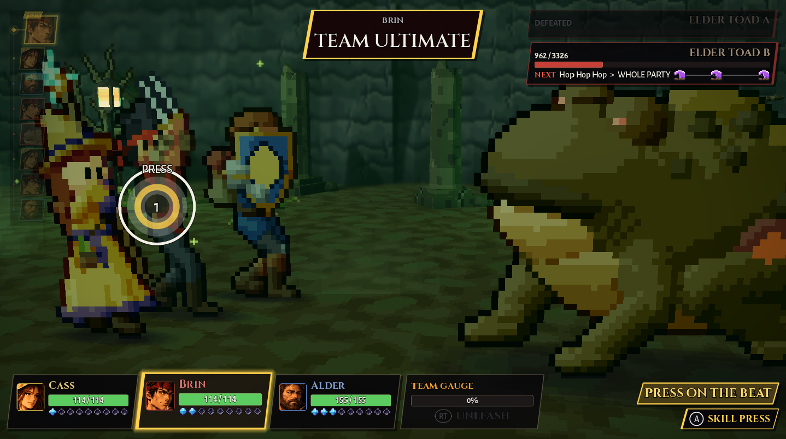
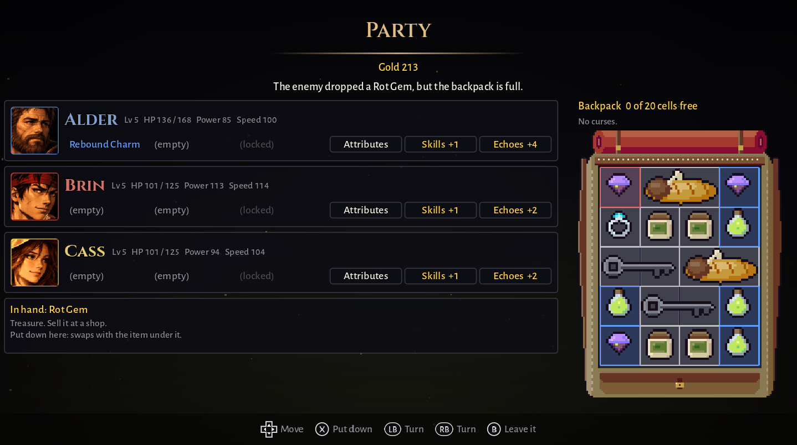

The rot rose from the Hollow King's grave and swallowed the land: forests to husks, rivers to bog,
cities to ash. Alder, Brin and Cass are the Rotsworn, the last three who swore to walk into the rot
and cut it out at its heart. The road is never the same twice, and the rot fights back.

**Rotsworn is a turn-based RPG roguelike for 1 to 3 players, on one PC or online.** You pick your
moves in turns, but you defend in real time: parry, dodge or jump each enemy hit on the beat. It is
inspired by *Clair Obscur: Expedition 33* (the fights) and *Octopath Traveler* (the HD-2D look),
and made with Godot 4.7.2.

| | | |
|---|---|---|
|  |  |  |
| Pick your road. It is never the same twice. | Fill the team gauge, then strike together. | Level up, give out Relics, pack the backpack. |

- [Play it](#play-it)
- [What's in the game](#whats-in-the-game)
- [Controls](#controls)
- [Play together](#play-together) (same PC, online, Tailscale)
- [For developers](#for-developers)
- [Credits](#credits)

## Play it

You need Windows 10 or 11 (64-bit). A controller is recommended, but keyboard and mouse work too.

1. Download **[Rotsworn.zip](https://github.com/JawadAlSaeed/Rotsworn/releases/download/latest-build/Rotsworn.zip)**
   (about 75 MB). This link always gives the newest build: GitHub rebuilds the game by itself
   after every change. The [latest-build page](https://github.com/JawadAlSaeed/Rotsworn/releases/tag/latest-build)
   says which version and change it is. If the browser warns that the file is not commonly
   downloaded, keep it (in Edge: **...** > **Keep** > **Show more** > **Keep anyway**).
2. Right-click the zip, pick **Extract All**, then open the new folder.
3. Double-click `Rotsworn.exe`.
4. If Windows says **"Windows protected your PC"**, click **More info**, then **Run anyway**. The
   game is not code-signed, so Windows does not know it yet. You may see this again after each
   update.

To update, download the zip again from the same link, extract it into the old game's folder and
pick **Replace the file in the destination**. Your settings, Relics and saved run are kept: they live in
`%APPDATA%\Godot\app_userdata\Rotsworn\`, not next to the exe.

The first time you choose **New Run**, the game offers a short tutorial. If you skip it, it offers
a 15-second lag check instead (if you play the tutorial, the lag check comes at your next New Run).
Both are worth doing. The tutorial is also under **Extras** on the main menu.

## What's in the game

### The heroes

The party is always the same three heroes. In co-op, the players share them.

| Hero | Weapon | What they do best |
|---|---|---|
| **Alder** | a big shield | Takes the hits and hits back. Taunt makes an enemy's next attack go to him; Payback grows with every perfect parry or jump since his last turn. |
| **Brin** | twin daggers | The damage. Fastest of the three. Rend hits for 300%, more on an Exposed enemy. All In is 6 quick stabs. |
| **Cass** | a crystal staff | Heals, revives and helps. Reveal makes an enemy Exposed; Mend, Sanctuary and Revive keep the party standing. |

Each hero has a skill tree of 3 branches with 3 skills each. A run starts with the first skill of
each branch; skill points unlock the rest. Each hero brings up to 5 skills into a fight.

### The fights

- **Turns.** Speed decides the turn order (the track down the left side). Enemies never hide what
  they will do: each one shows its next attack, who it targets and how many hits.
- **Your turn.** **Attack** (gives 1 AP), **Skills** (cost AP), **Items** from the backpack
  (1 AP), or **Run**: hold the button, then hit the ring perfectly. Only that hero gets away; the
  fight ends when every hero still standing has run. You cannot run from bosses, guards, elites
  or ambushes.
- **Press on the beat.** Your own attacks and skills have a ring to press on: **PERFECT** hits
  harder, **GOOD** is normal, a miss still lands for half. When a skill lands, the other heroes get
  a **FOLLOW-UP** press for an extra hit.
- **Team Ultimate.** Follow-ups fill the **TEAM GAUGE**. When it is full, press **UNLEASH**:
  everyone strikes together twice and every downed hero gets back up.
- **Defend in real time.** When an enemy attacks one of your heroes, that hero's player defends
  each hit:

  | Defence | Beats | Reward |
  |---|---|---|
  | **Parry** | normal hits, thrown hits, and Rends (bone-coloured claw icon, "MUST PARRY") | +1 AP |
  | **Dodge** | normal hits, thrown hits, and sweeps (green crescent icon, "MUST DODGE") | none, but the timing is easier |
  | **Jump** | ground waves and rock spikes (purple), and nothing else | none |

  One calm press per hit. Pressing too early, or mashing, locks your buttons for a moment.

- **Counters.** Defend every hit of an attack perfectly (parry, or jump the ground hits) and the
  hero strikes back. If the whole party does it, they strike back together as a **TEAM COUNTER**.
- **First strike.** A fight that starts with **FIRST STRIKE!** lets every hero act before any
  enemy. A Fight stop's name card shows one ring: press on the beat (**Space** or **E**, pad **A**
  or **RB**) as it closes. GOOD or PERFECT earns First Strike; early, late or no press starts the
  fight normally. Guards, elites, ambushes and bosses always start normally.
- **Dooms.** Guards and bosses charge one huge attack and count it down (*"TIMBER FALL IN 3"*).
  Deal enough damage in time and it **BREAKS**: the enemy is staggered, loses a turn and takes more
  damage.
- **Marks.** Every monster has one hit (a coloured dot on its icon) that leaves a mark if you
  fail to defend it: **ROT** (lose HP each turn), **BURN** (lose more, for fewer turns),
  **BLIGHT** (healing halved), **WEAK** (less power), **SHOCK** (smaller timing windows),
  **SLOWED** (later turns), **DAZE** (skip a turn) or **HUSH** (no skills), or it drains AP. The
  first row of a run's map has none. Cass's Mend, Sanctuary and Purify, the Salve, the Antidote and Holy
  Water lift marks, and they all end with the fight.
- **Monsters.** Each one tests something: quick Rot Rats in packs of three, an Ember Slinger and a
  Marsh Lantern that only throw, a huge slow Barrow Brute, a Rot Priest that heals and shields the
  others (kill it first), a Pus Tick that counts down and bursts. Up to three fight at once.

### A run

- **Three acts.** Each act is a branching map (6 rows of stops, then the boss) that is new every run,
  in one place of its own. You pick your path one stop at a time. Act 1 is *The Rotten Road*
  (Rotten Hollow); act 2, *The Drowned Mire* (Sunken Bog);
  act 3, *The Ashen Deep* (Ashen Ruins), uses tougher versions of every monster.
- **Stops on the map:**
  - **Fight**: one fight in a place (Rotten Hollow, Sunken Bog or Ashen Ruins), in its own light
    and weather. Win for gold, XP and sometimes an item. You may run away, but then you get nothing.
  - **Elite**: a much tougher fight with better spoils, and no running. It holds either an elite
    group or the place's **guard**, a mini-boss that rages at half health (never two guards in a
    row on one road). Beat it and pick one of three Relics.
  - **?**: an event. Every choice has a price (gold, max HP for the rest of the run, an item, a
    curse, a fight) or a risk, and some "?" stops are ambushes. 20 events in all.
  - **Treasure**: two chests. The plain one holds something rare and some gold; the rotten one
    lets you pick 1 of 3 Relics, but it may hold a curse or a monster too.
  - **Shop**: *The Rag Merchant* sells items and Relics. He also buys your items for half price,
    lifts a curse off the party and restocks his shelves, all for gold.
  - **Campfire**: pick one: rest (heal 50%) or train (an attribute point for every hero).
  - **Boss**: *The Husk Lord* ends act 1, *The Leech Queen* act 2 (her bites drink: a bite you
    do not stop heals her). *The Hollow King* is the final fight.
- **Getting stronger.** Each hero levels up on their own, up to level 10. Every level gives
  attribute points (Vitality, Might, Agility, Defense, Luck) and a skill point.
  Luck raises the chance of a critical hit.
- **The backpack.** One shared pack for the whole party: four pockets, one item each, and only
  things you use up (Salve, Feast, Bomb, Antidote, Smelling Salts, Holy Water). Treasure turns into
  gold the moment you find it.
- **Curses.** A curse sits on the whole party (you see it on the top strip, not in the pack) and
  every hero loses a little HP each turn in fights. You cannot throw it away: only a shop's Cleanse
  lifts it.
- **Saving.** The game saves the run by itself (an online run on the host's PC). **Save & Quit** in
  the pause menu takes you to the main menu, and **Continue** picks the run up (online, on the host's
  players screen, see [Online](#online)). If you quit in the middle of a stop, that stop starts
  over.

### Kept between runs

- **Relics** (50 of them). In a run they come from Elite stops, bosses, the rotten chest and the
  shop (and a few events): pick 1 of 3, then pick **who gets it**. A hero keeps every Relic given to
  them until the run ends: no slots, no limit, and a Relic the party has never turns up again. In
  co-op you give it to one of your own heroes (online the player whose turn it is picks). A Relic
  tagged **New** is not in your book yet. Every Relic you find goes
  in your **Relic book** for good (the main menu's **Relics** page: "Found 12 of 50"). Before each
  run, every hero takes one Relic from your book (**Starting Relics**; your first run starts with
  none). **Rot-touched** Relics are very strong, but each one comes with a price.
- **Oaths** make the game harder, one rule at a time (12 of them). Win a normal run to unlock
  oath 1, then win at each oath to unlock the next. Each oath keeps the rules of the ones before
  it. Pick it on the players screen before the run.

### And also

- **Tutorial**: one fight against a Rotten Husk at half speed, a short lesson for each move.
- **Glossary**: every word and icon of the game explained (also in the pause menu).
- **Rot Journal**: every enemy and attack you have met, and how well you defended them.
- **Settings**: graphics, sound, change keys and pad buttons, text size, screen shake, fewer
  flashes, and lag calibration (measured on its own for the keyboard and the pad).
- **The look**: pixel-art heroes and monsters in a 3D world built in Blender, with its own light,
  fog and shadows in every place. Music and sounds come from free recordings (see
  [Credits](#credits)).

## Controls

The game shows Xbox buttons when you use a pad and keys when you use the keyboard. You can change
each action's key and pad button in **Settings > Controls** (a few extra keys stay as they are,
such as the arrow keys next to WASD).

**In a fight**

| What | Keyboard | Pad (Xbox) |
|---|---|---|
| Attack | E | A |
| Skills | F | X |
| Items | Tab | Y |
| Team Ultimate (UNLEASH) | U | RT |
| Run | hold Backspace | hold B |
| Pick a target | arrow keys, then Enter | D-pad or left stick, then A |
| **Parry** | **Space** | **RB** |
| **Dodge** | **Shift** | **B** |
| **Jump** | **W** | **A** |
| Press on the beat (your own moves) | Space or E | A or RB |
| Pause | Esc | Menu (Start) |

**In menus**

| What | Keyboard | Pad (Xbox) |
|---|---|---|
| Move | arrow keys or WASD | D-pad or left stick |
| Confirm | Enter or E | A |
| Back | Backspace, Q or Esc | B |
| Previous / next hero, or Settings section | Z / C | LB / RB |

The mouse works in most menus: point to choose, left click to confirm, right click to go back. The
party screen's hero cards and the Attributes and Skills screens still need the keyboard or a pad. The mouse does nothing in fights, so a click can never be a parry.

More controls: the party screen, the backpack, the map, F1 and F2

| Where | Keyboard | Pad (Xbox) |
|---|---|---|
| Map: choose the next stop / scroll / go | Left, Right / Up, Down / Enter | D-pad / D-pad / A |
| Map: open the party screen (level up, Relics, backpack) | Tab | Y |
| Backpack: an item's menu (use, sell, throw away), or put a find in a pocket | Enter | A |
| Party screen: Attributes / Skills | T / K | LT / RT |
| Shop: buy / sell / leave | Enter / Tab / Backspace | A / Y / B |
| Defence stats in a fight | F1 | View |
| Lag calibration (while the fight menu is open) | F2 | |

F1 and F2 work in fights on one PC, not in online fights. Lag calibration is also in
**Settings > Game** (online too).

To change a key: **Settings > Controls**, pick the action, choose the Key or Pad side, press
Confirm, then press the new key or button. If it is already used, the game offers to swap them.
"Reset to defaults" is at the bottom of the list.

## Play together

Up to 3 players. There are always three heroes, so the players share them:

- 1 player: you play all three.
- 2 players: P1 plays Alder and Cass, P2 plays Brin.
- 3 players: one hero each.

On the players screen, put the cursor on a hero card and press Left or Right to give that hero to
someone else. Every player keeps at least one hero.

Each player picks the turns of their own heroes and defends them.

### On one PC

The keyboard counts as one player and each pad counts as one player. So you can play with the
keyboard and 1 or 2 pads, or with 2 or 3 pads. Two people cannot share the keyboard.

1. Main menu: **New Run**. The players screen opens. Whoever opened it is P1.
2. Player 2 (and 3): press **A** on your own pad (or **Enter** if you have the keyboard).
3. Choose **Start**.

During the run a friend can join, leave or swap heroes: pause, then **Players**. A new player
presses **A** (or **Enter**) there.

If a pad comes unplugged, the game waits. Plug it back in, or press a button on another pad to
take over.

### Online

One player per PC, up to 3 PCs: the host plus 2 friends.

**Everyone must play the exact same build.** Everyone, the host too, downloads `Rotsworn.zip` from
the one link in [Play it](#play-it). Do not play from the Godot editor or from a zip you built
yourself with `build_game.bat`: those are different builds. The link gets a new build after every
change to the game, so download it again together before you play. The version number shows in
the bottom-left corner of the main menu, but even builds with the same number can differ.

**The host:**

1. Main menu: **Online > Host Online**.
2. The first time, Windows Firewall asks about Rotsworn. Tick **Private networks** and click
   **Allow access**.
3. The screen says *"Friends join with this address: ..."* and lists your PC's addresses. Tell
   your friends the right one:
   - Same home network (same Wi-Fi): the one that starts with `192.168.` (or `10.`).
   - Over the internet with Tailscale (below): the one that starts with `100.`.
4. Wait until your friends show up on the list (`P2 Online`), hand out the heroes, pick the oath
   if you like, then choose **Start**. A friend who comes later can still join the run while it
   is going: they join the same way and take one of your heroes.

**A friend:**

1. Main menu: **Online > Join Online**.
2. Type the host's address, only the numbers, for example `100.101.102.103`. Do **not** add a port
   (`:7777`); the game always uses port 7777.
3. Press **Enter** (or **A**). The game remembers the address for next time.
4. Wait for the host to start. If the run is already going, you join it and see where the host is;
   one of the host's heroes becomes yours a moment later.

**During an online run:**

- The run's choices go in turns: each map step, stop and spoils pick belongs to the next player
  (P1, P2, P3, then P1 again). A chip at the top left shows whose turn it is (for example `P2`). On
  someone else's turn the choices are greyed: watch, or look at the party screen. If a find
  has no room in the backpack on your turn, your backpack opens so you can place it. The host can
  switch this off in **Settings > Game > Take turns**; then the host makes every choice. Everyone
  plays their own heroes' turns and defends their own heroes.
- Pausing does **not** stop an online game, not even for you: the fight goes on behind the menu.
  Do not pause in the middle of a fight.
- Before the run, each player picks the starting Relics for their own heroes from their own Relic
  book (the host waits up to 90 seconds). A friend who joins later gets none. Each friend also keeps
  what the run finds while they are in it (new Relics) in their own book.
- If your connection drops, the host keeps your seat for 2 minutes and plays your heroes for you.
  Your game opens the Join screen by itself: press **Enter** (or **A**) to take your seat back. If
  your game closed or crashed, start it again and join the same address within those 2 minutes:
  your seat comes back.
- To quit: pause, then **Leave the game** (a friend; your heroes go to the host), **Save & Quit**
  (the host; everyone goes to the main menu and the run is kept) or **End the game** (the host; the
  run and its save are lost for everyone).
- To go on with a saved online run: the host picks **Online > Host Online** again, and the
  players screen shows **Continue** next to **Start**. Friends join the same address as before
  (before or after the host presses Continue) and get their own seats and heroes back. A seat waits
  5 minutes for its friend; if you quit in the middle of a stop, that stop starts over.

### Over the internet with Tailscale

Same Wi-Fi works as it is. Over the internet, the simplest way is
[Tailscale](https://tailscale.com): a free app that puts your PCs on one private network, as if
you were in the same house. No router settings needed. The free plan is plenty for 3 players.

**Everyone:**

1. Download Tailscale from <https://tailscale.com/download/windows> and install it.
2. A Tailscale icon appears in the taskbar, near the clock (click the small up arrow if you do not
   see it). Right-click it and choose **Log in**. Sign in with Google, Microsoft or GitHub. It is
   free.

**The host:** share your PC with your friends.

3. Open <https://login.tailscale.com/admin/machines> and find your PC in the list.
4. Click the **...** button at the end of its row and choose **Share**. Open the **Copy invite
   link** tab, turn on **Reusable link** (a normal link works for one friend only), then click
   **Copy share link**. Send it to your friends (treat it like a password).

**Each friend:**

5. Open the link, sign in with your Tailscale account, and accept. The host's PC now shows in your
   Tailscale list.

**Play:**

6. The host starts Rotsworn and picks **Online > Host Online**. The address that starts with
   `100.` is the one to send (it is also on the **My address** line in the host's Tailscale menu).
7. Friends pick **Online > Join Online** and type that `100.x.x.x` address. If it does not
   connect, find the host's PC in your own Tailscale list and use the `100.` address shown there
   (a shared PC can get a different address on your side).

Tailscale must be running (icon in the taskbar, logged in) on every PC while you play. A shared PC
can only be joined, so with these steps the same person always hosts. If you want to take turns
hosting, the host can instead invite friends into their own Tailscale network: on the admin page,
**Users > Invite external users**. Invited friends can see all of the host's devices on it, so only
do this with people you trust.

**Other ways:** forward **UDP port 7777** on the host's router to the host's PC, then friends type
the host's public IP address. This fails on some internet connections (CGNAT). Other free
"virtual LAN" apps such as ZeroTier or Radmin VPN work the same way as Tailscale.

### If joining does not work

| You see | What to do |
|---|---|
| *"Your game is a different version from the host's ..."* | You have different builds. All of you download `Rotsworn.zip` again from the link in [Play it](#play-it) and extract it over the old one. |
| *"The host did not answer."* or *"Host not found"* | Check the address. The host must be on the Host Online screen and must have allowed Rotsworn in the firewall question. With Tailscale, check it is running and logged in on both PCs. On the same Wi-Fi, see the note below the table. |
| *"Could not start connecting ..."* | The address is not valid. Type only the numbers and dots, for example `100.101.102.103`, with no `:7777` and no spaces. |
| *"Game full"* | 3 players is the most. In a run, a seat may still be kept for a friend who dropped out (for up to 2 minutes; in a saved run the host continued, for up to 5 minutes), or nobody has a spare hero to give you. Try again later. |
| *"Run busy, try again"* | The run is starting or ending right now. Wait a moment and join again. You can join a run that is already going. |
| *"Could not host (another game hosting?)"* | Close the other copy of Rotsworn. |

If the host clicked Cancel on the firewall question: Windows Security > Firewall & network
protection > Allow an app through firewall > Change settings > tick **Private** for Rotsworn >
OK. If you extract a new build into a different folder, Windows may ask again.

Same Wi-Fi but friends still cannot reach the host? Windows often marks a new Wi-Fi as a public
network, and then the firewall still blocks the game. On the host's PC: Settings > Network &
internet > Wi-Fi > your network's properties > pick **Private network**. (Tailscale does not need
this.)

## For developers

The full design is in [docs/DESIGN.md](docs/DESIGN.md). Project rules are in [CLAUDE.md](CLAUDE.md).

**Run from source**

1. Install Godot 4.7.2 (standard build, not .NET).
2. After cloning, run `git config core.hooksPath .githooks` once.
3. Set the `GODOT` environment variable to your Godot console exe
   (`Godot_v4.7.2-stable_win64_console.exe`) and `GODOT_EDITOR` to the normal exe. Every script
   reads them; without them, the scripts look in `C:\Users\Drago\Godot\`.
4. Double-click `run_game.bat`. Or open the editor with `open_editor.bat` and press F5.

**Other scripts**

| Script | What it does |
|---|---|
| `run_tests.bat` | Runs every unit test (GUT) without a window. Prints ALL TESTS PASSED or SOME TESTS FAILED. |
| `build_game.bat` | Builds the game into `build/Rotsworn.zip` (one exe) on your PC, to test a build. Needs Godot's 4.7.2 Windows export templates (editor: Editor > Manage Export Templates). It is not the build friends download (see below), so do not play it online with them. |
| `quiet_run.bat` | Runs the game in a window that never takes focus and makes no sound, for picture and bot runs. |
| `open_editor.bat` | Opens the project in the Godot editor. |

**The download link** builds itself. Every push to `main` that changes more than Markdown or
`docs/` runs [.github/workflows/build.yml](.github/workflows/build.yml) on GitHub Actions: it
imports the project, runs the tests, exports the Windows game the same way `build_game.bat` does
and replaces `Rotsworn.zip` on the `latest-build` pre-release. If a test or the export fails,
nothing is published and the old zip stays. Watch it under the repo's **Actions** tab; it can also
be started by hand there (**Build game** > **Run workflow**).

**Dev tools** (the Practice list and the switches below exist only in debug builds: the editor and
`run_game.bat`, never the shared zip):

- **Practice** under Extras: any fight on its own. Keys: 1 to 9 pick the enemy's next
  attack, I party can't die, O enemy can't die, R restart, F1 stats (inside: R training ring,
  G telegraph flash, T timing readout, L motion sounds, H hit markers, C wind-up crouch,
  V cinematic camera).
- **A bot that plays for you**: `run_game.bat -- --autoplay --run --quit-on-end` plays a whole run.
  Put `--headless` before the `--` for no window (`run_game.bat --headless -- --autoplay ...`).
  Add `--players=2` for co-op, or `--encounter=ID` for one fight (ID is a file name in
  `data/encounters/`, for example `husk_fight`).
  The main switches are explained in [CLAUDE.md](CLAUDE.md); the full list is at the top of
  `scripts/combat/presentation/combat_options.gd`.

**Where things live**

- Rules and timing numbers: `data/tuning/tuning.tres`. How things look and feel:
  `data/presentation/`. How each place looks: `data/looks/`. Change them in the editor's Inspector.
- Characters, enemies, attacks, skills, items, Relics, events and places are all data files in
  `data/`.
- Pixel art: `python tools/art_kit/build.py`. 3D world pieces: `tools/blender_kit/` (Blender, no
  window). Sound effects: `tools/sound_kit/`. Each has its own README.

## Credits

Made by Jawad Al-Saeed (DragonRot). Made with [Godot Engine](https://godotengine.org).

- Music and sound effects: free recordings (CC0 and CC-BY) from OpenGameArt.org, Freesound.org and
  Kenney. The full list, with links, is in [music](assets/audio/music/CREDITS.md),
  [sound effects](assets/audio/sfx/CREDITS.md) and [ambience](assets/audio/ambience/CREDITS.md).
  The game shows the authors under **Extras > Credits**.
- Fonts: Cinzel and Alegreya Sans (SIL Open Font License).
- Inspired by *Clair Obscur: Expedition 33* and *Octopath Traveler*.
